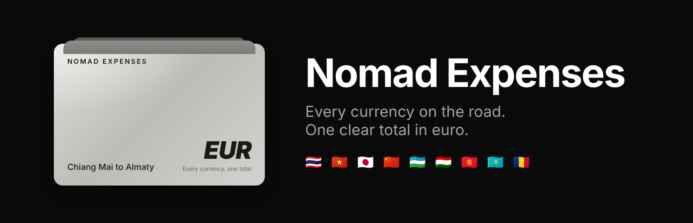
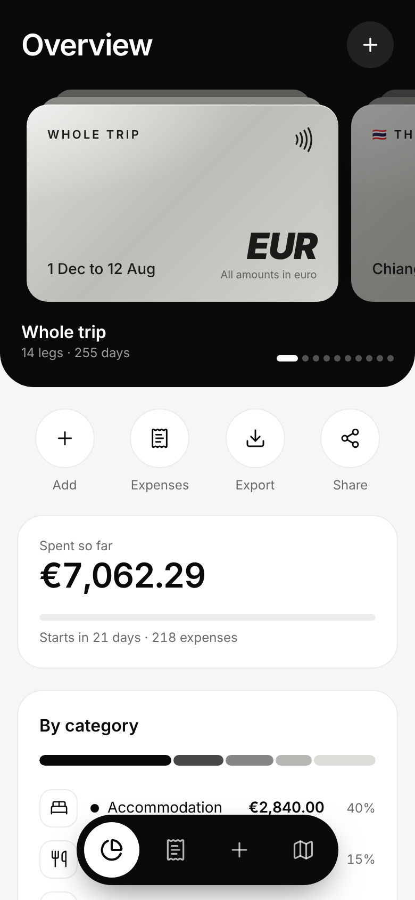
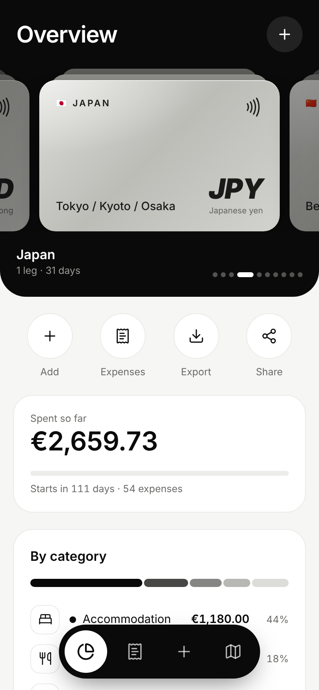
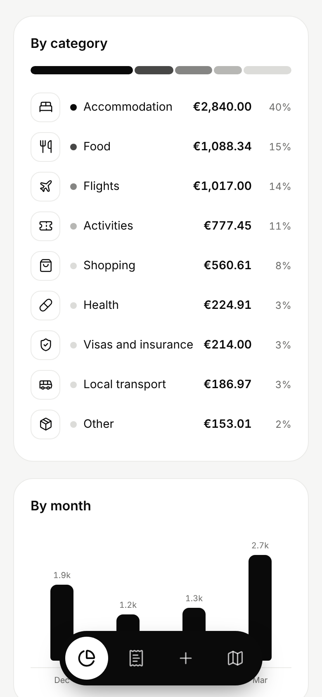
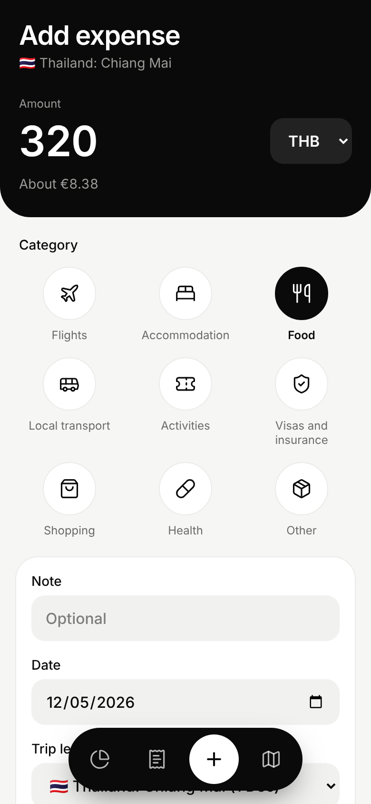
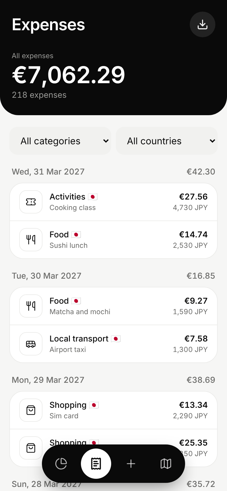
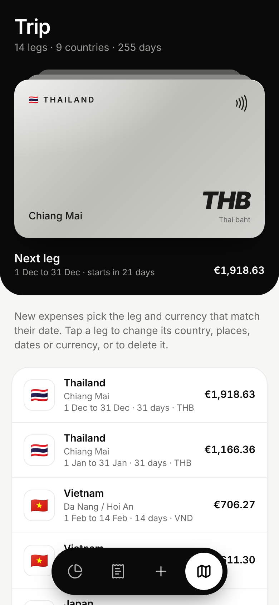
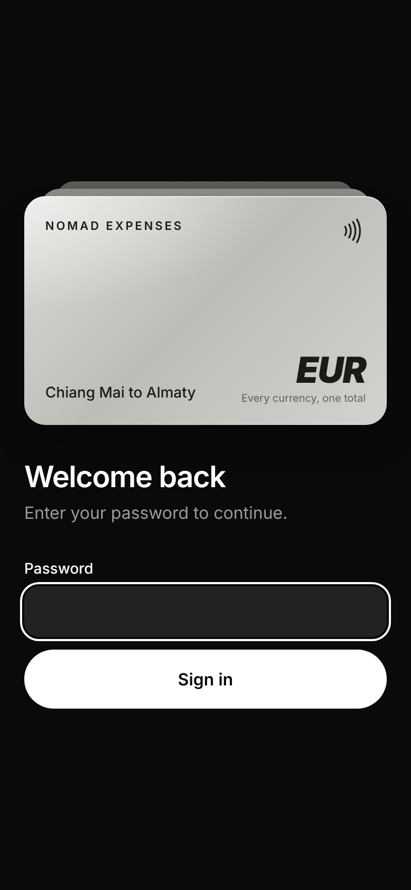
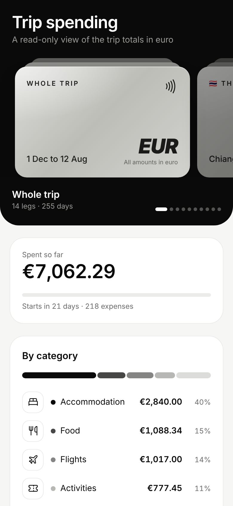
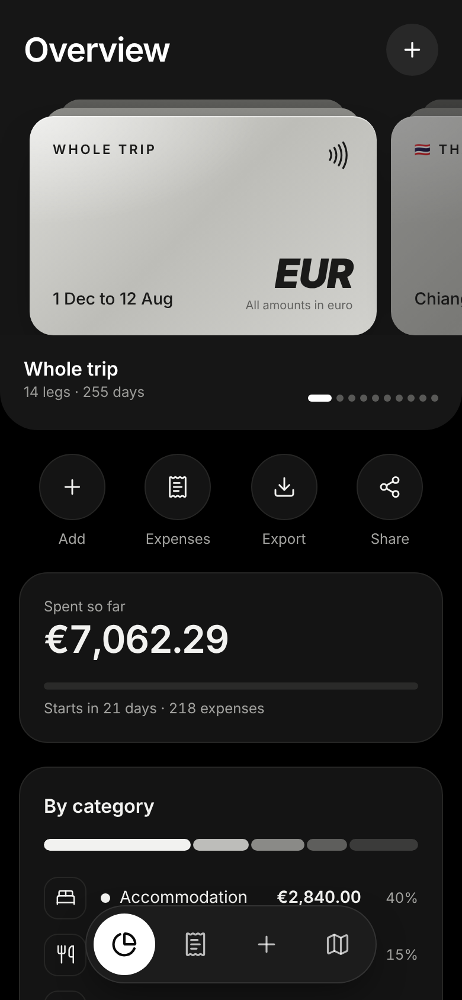

<p align="center">
  
</p>

<h1 align="center">Nomad Expenses</h1>

<p align="center">
  <strong>Every currency on the road. One clear total in euro.</strong>
</p>

<p align="center">
  A small mobile-first web app for long trips across many countries.<br />
  Log an expense in a few taps in whatever currency you paid, then see what the whole trip cost<br />
  by category, by month, by country and by trip leg.
</p>

<p align="center">
  
  
  
  
  
  
</p>

<p align="center">
  <a href="#-quick-start-under-5-minutes">Quick start</a> ·
  <a href="#what-the-app-includes">Features</a> ·
  <a href="#screenshots">Screenshots</a> ·
  <a href="#the-itinerary">Itinerary</a> ·
  <a href="#roadmap">Roadmap</a> ·
  <a href="#development">Development</a>
</p>

<p align="center">
  Author: <a href="https://www.nomad-developer.co.uk/">Costin Botez</a> (<a href="https://www.instagram.com/costinbotez/">@costinbotez</a>) ·
  <a href="https://www.nomad-developer.co.uk/">Portfolio</a> ·
  <a href="https://www.instagram.com/costinbotez/">Instagram</a> ·
  <a href="https://github.com/costibotez">GitHub</a>
</p>

---

## Why Nomad Expenses exists

Nine months on the road through nine countries means nine currencies. Every one of them makes the same question harder: *"what has this trip actually cost so far?"* Nomad Expenses answers it from data you enter in seconds:

- You pay 320 baht for dinner in Chiang Mai. You type the amount, tap **Food** and save. The app already knows you are in Thailand, already picked baht and already converted it to euro at the rate for that day.
- Months later in Almaty you open the overview and see flights, accommodation, food and everything else as euro totals, for the whole trip or for a single country.

## What the app includes

### ➕ Fast expense entry
- Amount, category and save. Three taps for a typical expense
- The **trip leg and currency follow the date**: an expense dated 5 December picks Thailand and Thai baht on its own
- Any expense can use another currency, because flights and bookings are often charged in euro or dollars
- Nine categories: flights, accommodation, food, local transport, activities, visas and insurance, shopping, health and other
- A live euro preview while you type, plus the five most recent expenses under the form
- **Repeat in one tap**: each recent expense has a repeat button that adds it again dated today, with the leg and rate for the new day. An **Undo** link covers a slip of the thumb

### 💱 Currency conversion that never drifts
- Eleven currencies: euro, dollar, Romanian leu, Thai baht, Vietnamese dong, Japanese yen, Chinese yuan, Uzbek som, Tajik somoni, Kyrgyz som and Kazakh tenge
- The exchange rate is looked up **for the day of the expense** and saved with it, so old totals never shift when rates move
- Three free rate sources are tried in turn and none of them needs a key
- No signal or no rate? Type your own rate. You can switch back to the looked-up one at any time

### 🧾 Expense list
- Grouped by day with a total for each day
- Filter by category and by country
- Tap any expense to edit or delete it
- Each row shows both the amount you paid and its value in euro

### 💳 Overview in a card layout
- A **silver card for the whole trip and one for each country**, each showing its local currency. Swipe between them and every number below follows the card in front
- Round shortcuts under the card to add an expense, open the list, export or share
- **Spent so far** with the cost per day and a progress bar for the days of the trip or the country
- **By category**: a segmented bar plus a list with the amount and share of each category
- **By month**: spending over time
- **By country** and **by trip leg**, with a cost per day for each leg
- Light and dark mode follow your phone setting

### 🗺️ Editable itinerary
- All 14 legs of the trip are loaded the first time the app is built
- Tap a leg to change its **country, places, dates or default currency** when your plans move
- **Add a leg** for a new country. Every country has its flag, and the currency is suggested for you from more than 160
- **Delete a leg** you no longer need. Its expenses stay and show as not tied to a leg
- The current leg is highlighted and every leg shows what it has cost so far

### 📤 Spreadsheet export
- One file with every expense: date, country, places, category, note, amount paid, currency, rate and amount in euro
- Opens directly in Excel, Numbers and Google Sheets

### 🔗 Read-only share links
- Create a unique link on the **Trip** screen and send it to family or friends
- The link opens the trip totals and charts **without a password** and without any way to add or change data
- It shows totals only. Single expenses, notes and the export stay private
- Create as many links as you like and switch any of them off at any time

### 🔒 Private by design
- **One password** protects every page and every data route. The only exception is a share link you created yourself
- Your data lives in your own Postgres database and nowhere else
- No analytics, no trackers and no third party accounts. The only outside requests are the exchange rate lookups, which carry a currency and a date and nothing about you
- Search engines are told not to index the site

### 📱 Feels like an app
- Add it to your phone home screen and it opens full screen with its own icon
- Large touch targets and a floating navigation bar made for one-handed use
- A monochrome card design with line icons, built to look at home next to a banking app

## ⚡ Quick start (under 5 minutes)

1. Import this repository as a new project on [Vercel](https://vercel.com/new).
2. In the project, open **Storage** and add a **Neon Postgres** database. This sets `DATABASE_URL` for you.
3. In **Settings → Environment Variables**, add `APP_PASSWORD` with a long password of your choice.
4. Deploy. The build creates the tables and loads the itinerary the first time.
5. Open the site on your phone, sign in and choose **Add to Home Screen**.

## The itinerary

| Dates | Country | Places | Currency |
|---|---|---|---|
| December 2026 | 🇹🇭 Thailand | Chiang Mai | Thai baht |
| January 2027 | 🇹🇭 Thailand | Chiang Mai | Thai baht |
| 1 to 14 February 2027 | 🇻🇳 Vietnam | Da Nang / Hoi An | Vietnamese dong |
| 15 to 28 February 2027 | 🇻🇳 Vietnam | Ho Chi Minh City | Vietnamese dong |
| March 2027 | 🇯🇵 Japan | Tokyo / Kyoto / Osaka | Japanese yen |
| 1 to 7 April 2027 | 🇨🇳 China | Beijing | Chinese yuan |
| 8 to 13 April 2027 | 🇨🇳 China | Zhangjiajie (Avatar Mountains) | Chinese yuan |
| 14 to 19 April 2027 | 🇨🇳 China | Xi'an | Chinese yuan |
| 20 to 30 April 2027 | 🇨🇳 China | Urumqi / Turpan | Chinese yuan |
| 1 to 20 May 2027 | 🇺🇿 Uzbekistan | Tashkent / Samarkand / Bukhara / Khiva | Uzbek som |
| 21 May to 10 June 2027 | 🇹🇯 Tajikistan | Dushanbe / Fann Mountains / Iskanderkul | Tajik somoni |
| 11 June to 10 July 2027 | 🇰🇬 Kyrgyzstan | Bishkek / Issyk-Kul / Karakol / Song-Kul | Kyrgyz som |
| 11 July to 11 August 2027 | 🇰🇿 Kazakhstan | Almaty / Charyn Canyon / Kolsai Lakes / Astana | Kazakh tenge |
| 12 August 2027 | 🇷🇴 Romania | Bucharest (Return Home) | Romanian leu |

Planning a different trip? Edit `scripts/legs-seed.json` before the first deployment, or add, change and delete legs afterwards on the **Trip** screen.

## Roadmap

- Offline entry that syncs when a connection returns, for the Fann Mountains and Song-Kul
- Budgets per leg and per category with the remaining amount
- Receipt photos attached to an expense

## Screenshots

The amounts below are sample data.

| Overview | One country | Categories and months |
|---|---|---|
|  |  |  |

| Add expense | Expenses | Trip |
|---|---|---|
|  |  |  |

| Sign in | Share view | Dark mode |
|---|---|---|
|  |  |  |

## Development

- Next.js 16 with the App Router, React 19, TypeScript and Tailwind CSS 4. Data access uses Drizzle on Postgres. Icons come from Lucide.
- **Run it locally:** copy `.env.example` to `.env.local`, fill in both values, then:

```bash
npm install
npm run db:migrate
npm run dev
```

- **Migrations run before every build.** `npm run build` first runs `scripts/migrate.mjs`, which applies the files in `drizzle/` and loads the itinerary into an empty database. A fresh deployment needs no manual database step.
- **Changing the schema:** edit `lib/db/schema.ts`, run `npm run db:generate` and commit the new file in `drizzle/`.
- **Charts are plain HTML and CSS.** There is no chart library to load on a slow connection.
- **Exchange rates** come from the fawazahmed0 currency data set, first through jsDelivr and then through Cloudflare Pages, with open.er-api.com as the last fallback. See `lib/rates.ts`.

```
proxy.ts               Password gate in front of every page and data route
app/
  (app)/               Add, Expenses, Overview and Trip screens
  share/[token]/       Public read-only totals behind a share link
  login/               Sign-in page
  api/rate/            Rate lookup used by the expense form
  api/export/          Spreadsheet export
  actions.ts           Server actions: sign in, expenses, legs and share links
components/            Card layout pieces, card carousel, expense form, overview, charts, navigation
lib/
  db/                  Drizzle schema and database client
  rates.ts             Exchange rate lookup with three sources
  constants.ts         Categories and currencies
  format.ts            Money and date formatting
scripts/
  migrate.mjs          Migrations and first-time itinerary load
  legs-seed.json       The itinerary
drizzle/               Generated SQL migrations
docs/                  Banner and screenshots for this page
```

Environment variables:

| Variable | Purpose |
|---|---|
| `DATABASE_URL` | Postgres connection string. The Neon integration on Vercel sets it |
| `DATABASE_URL_UNPOOLED` | Optional direct connection, preferred for migrations when present |
| `APP_PASSWORD` | The password you type to open the app. Changing it signs every device out |

Useful scripts:

| Script | Purpose |
|---|---|
| `npm run dev` | Start the development server |
| `npm run build` | Run migrations, then build for production |
| `npm run db:migrate` | Apply migrations and load the itinerary into an empty database |
| `npm run db:generate` | Create a migration after a schema change |
| `npm run lint` | Check the code with ESLint |

Where to change common things: categories and currencies live in `lib/constants.ts`.

---

<p align="center">
  
</p>

<p align="center">
  Built and maintained by <a href="https://www.nomad-developer.co.uk/">Costin Botez</a> at <a href="https://www.nomad-developer.co.uk/">Nomad Developer</a> · <a href="https://www.instagram.com/costinbotez/">@costinbotez</a><br />
  Made for a nine month journey from Chiang Mai to Almaty.
</p>
